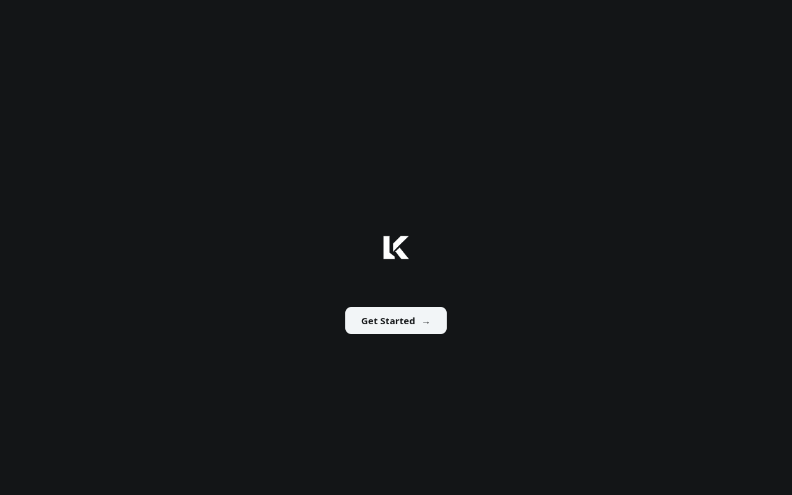
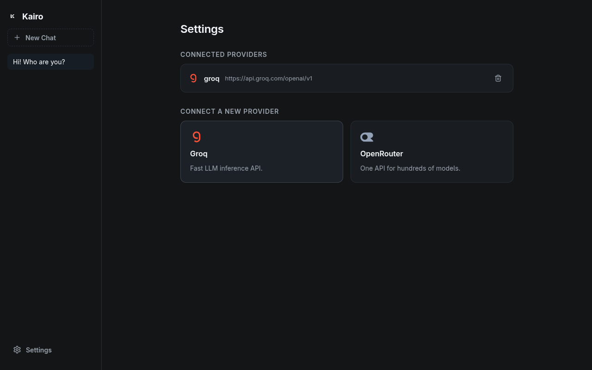

<div align="center">
	

</div>

---

Kairo connects Groq, OpenRouter, Ollama, Gemini and any **OpenAI-compatible provider** to a single sleek desktop app. Your keys, history and model choices all stay **on your own machine** — no cloud, no telemetry.

## Features

- **Searchable model picker** — your provider's full `/models` catalog in one popup, filtered as you type
- **Conversation history** — chats are stored in local SQLite; every request sends the last **15 messages** to the model as context
- **Encrypted keys** — API keys are sealed with **AES-256-GCM** and never stored in plain text
- **Smart chat titles** — sidebar names are derived automatically from your first message
- **Frameless UI** — a soft dark theme: your words on the right, the model's answer on the left with a brand avatar
- **Fast** — a solid Go binary does the heavy lifting; Electron only draws the window

<div align="center">
	<a href="web/screenshots/welcome.png"></a>
	<a href="web/screenshots/settings.png"></a>
</div>

## Getting started

**Requirements:** Go 1.27+ · Node.js 20+ (tested with Electron 44)

```bash
git clone https://github.com/coderianx/kairo.git
cd kairo
npm install
npm run build:backend   # builds the Go backend (kairo-server)
npm start
```

> After any change to the Go code, run `npm run build:backend` again — Electron cannot start without the `kairo-server` binary.

### Linux AppImage

```bash
npm run dist
```

Output: `dist/Kairo-<version>.AppImage` — the Go backend is embedded in the package, ready for single-file distribution.

## Usage

1. **Settings → connect a provider:** pick a card and hit Apply — for Groq/OpenRouter/Gemini paste your API key (encrypted and stored in your local database); **Ollama needs no key**, it connects to your local instance straight away.
2. Open a conversation with **New Chat**; the sidebar name is derived automatically from your first message.
3. Pick a **provider and model** from the composer pills; models are fetched from your provider, searchable as you type.
4. Type and hit **Enter** — every answer is produced with the last 15 messages of the conversation as context.

## Allowed Providers

These providers are built in — the base URL is resolved server-side from the provider name, so you just pick the matching card and connect:

| Provider | Base URL | API key |
| --- | --- | --- |
|  **Groq** | `https://api.groq.com/openai/v1` | Required |
|  **OpenRouter** | `https://openrouter.ai/api/v1` | Required |
|  **Ollama** | `http://localhost:11434/v1` | Not needed — local |
|  **Gemini** | `https://generativelanguage.googleapis.com/v1beta` | Required |

Notes:

- **Ollama** runs on your own machine — make sure the Ollama server is up (`ollama serve`) before connecting; no API key is asked for.
- Keys for the cloud providers are encrypted with AES-256-GCM before they touch the database (see [Privacy](#privacy) and [Data](#data)).
- Every provider above is OpenAI-compatible on the wire (`/models` + `/chat/completions`), which is what keeps the backend a single small client.

## Privacy

**Kairo Cares About Your Privacy** — your keys never leave your machine and your chats never leave your disk. There is no cloud in Kairo, and no telemetry.

## Data

- `~/.kairo/kairo.db` — providers, chats and messages (SQLite, WAL mode)
- `~/.kairo/secret.key` — generated 32-byte secret used for key encryption (permissions `0600`)
- `KAIRO_SECRET_KEY` — optionally provide a fixed hex key instead

## Architecture

`ui (electron) → ipc → kairo-server (go, :8080) → provider api`

Settings, chats and messages live in local SQLite; model requests go through kairo-server to the configured provider with the decrypted key.

## Development

```bash
go test ./...                          # Go tests
npm run build:backend && npm start     # run after changes
npm run dist                           # package an AppImage
```

## Contributing

PRs and issues are welcome — for large changes, please open an issue first so we can discuss the approach.

## License

[MIT](LICENSE) — © 2026 coderianx
